# Evidence-labelled architectural diagrams

## Focused Torch Human / bot-personality follow-up

Focused diagrams now separate configured bots, legacy/book move selection and local-vs-remote Human review. They supersede any interpretation equating these paths.

[Evidence-graded focused update](torch-human-bots-update/00_START_HERE.md) · [Overlay change manifest](TORCH_HUMAN_BOTS_PATCH_MANIFEST.md). This additive notice supersedes narrower earlier interpretations; it does not alter archived original documents.

---

[Master index](00_MASTER_INDEX.md)

Solidlinesrepresentobservedcode/datarelationships;dashed lines explicitly label inference/unknowns. LogicalmodelsarenotSQLschemas. Diagram12isasmallrevieweddirectcallslice,not a fabricated complete callgraph. Machinegraphsretainallrecoveredpairs.

## High-level website

[Mermaid source](diagrams/01-high-level.mmd)

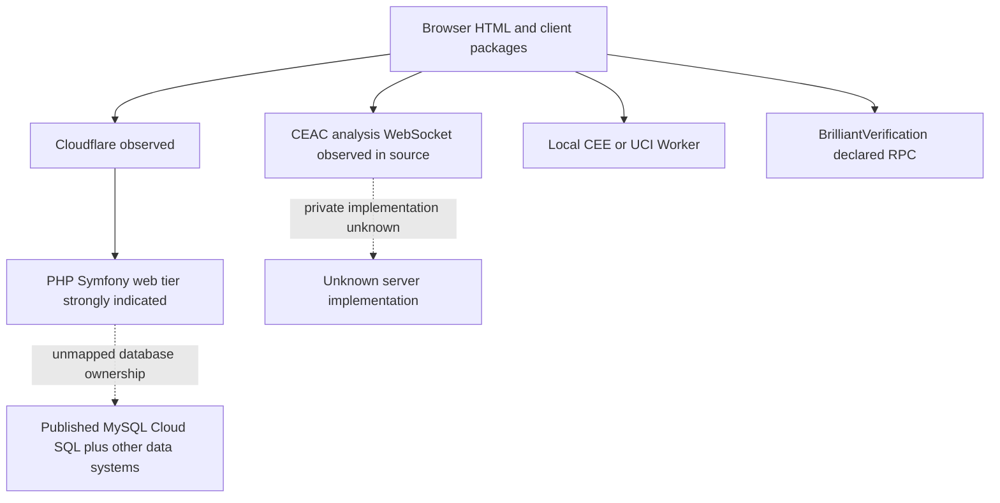

## Frontend hierarchy boundaries

[Mermaid source](diagrams/02-frontend-components.mmd)

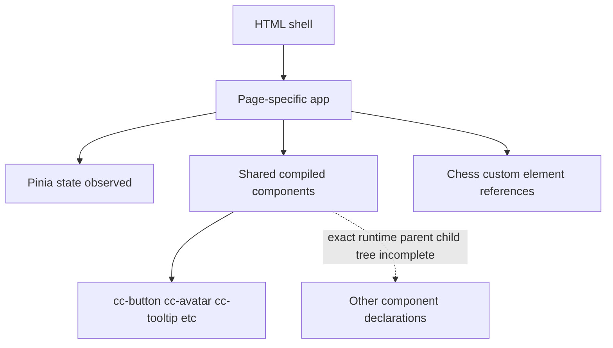

## UI to backend communication

[Mermaid source](diagrams/03-ui-backend.mmd)

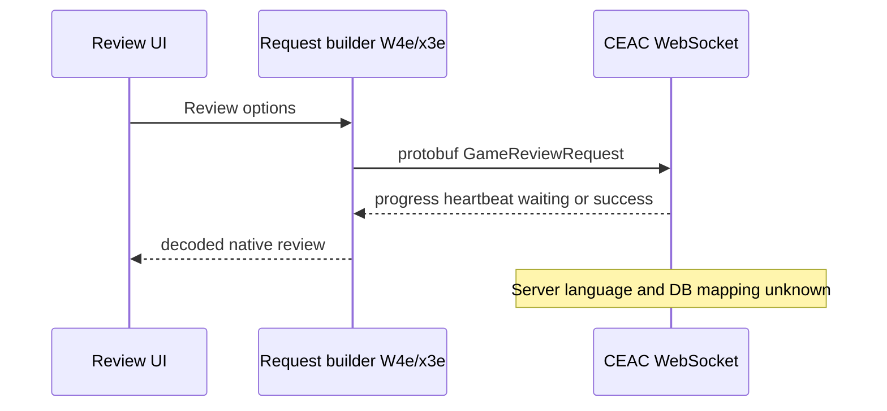

## Routing and controllers

[Mermaid source](diagrams/04-routing.mmd)

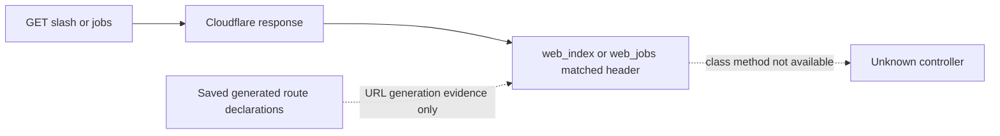

## Service and business boundaries

[Mermaid source](diagrams/05-services.mmd)

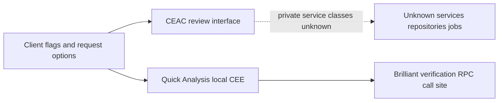

## Database/model boundary NOT a database ERD

[Mermaid source](diagrams/06-data-model-boundary.mmd)

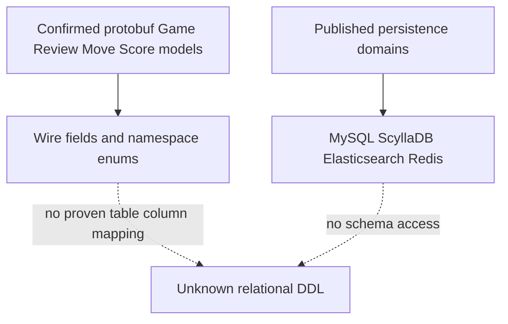

## Observed public request lifecycle

[Mermaid source](diagrams/07-request-lifecycle.mmd)

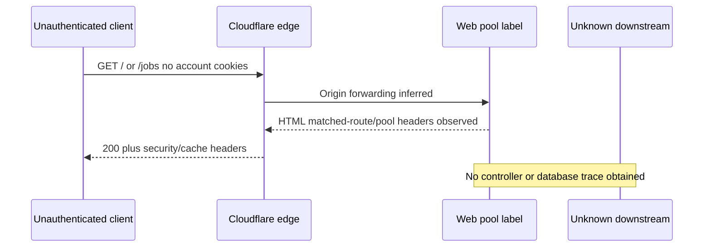

## Extension local review workflow

[Mermaid source](diagrams/08-workflow.mmd)

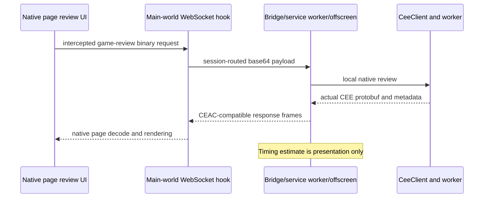

## Deployment evidence

[Mermaid source](diagrams/09-deployment.mmd)

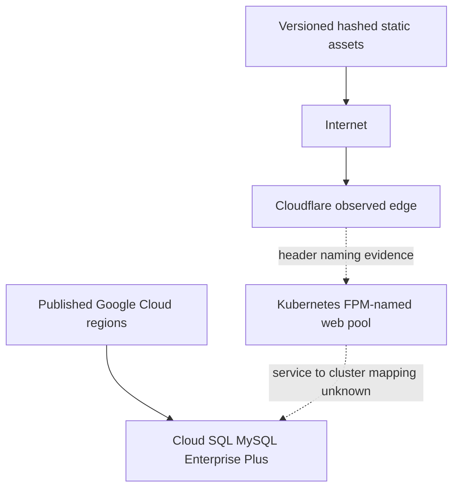

## JavaScript to WASM boundary

[Mermaid source](diagrams/10-js-wasm.mmd)

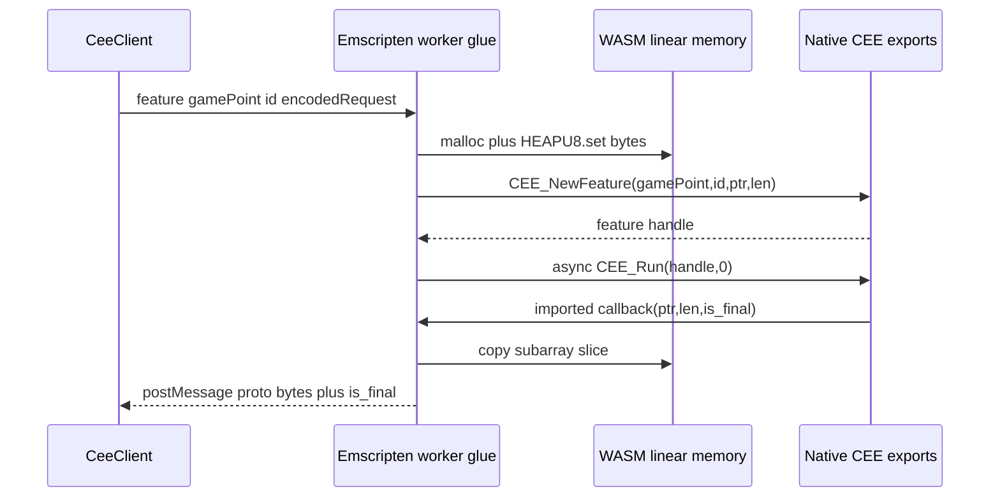

## WASM imports and exports

[Mermaid source](diagrams/11-wasm-host.mmd)

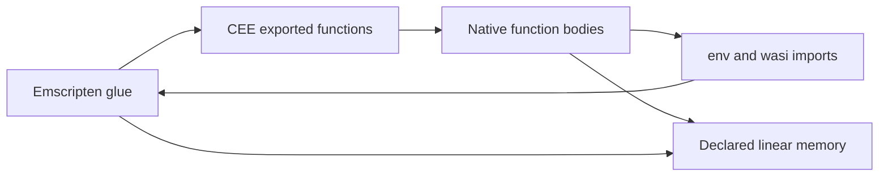

## Recovered direct-call slice

[Mermaid source](diagrams/12-wasm-internal.mmd)

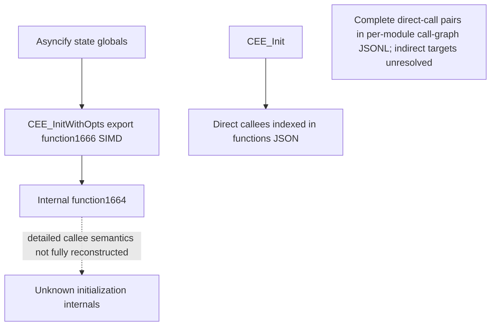

## Alternative data paths involving WASM

[Mermaid source](diagrams/13-data-flow.mmd)

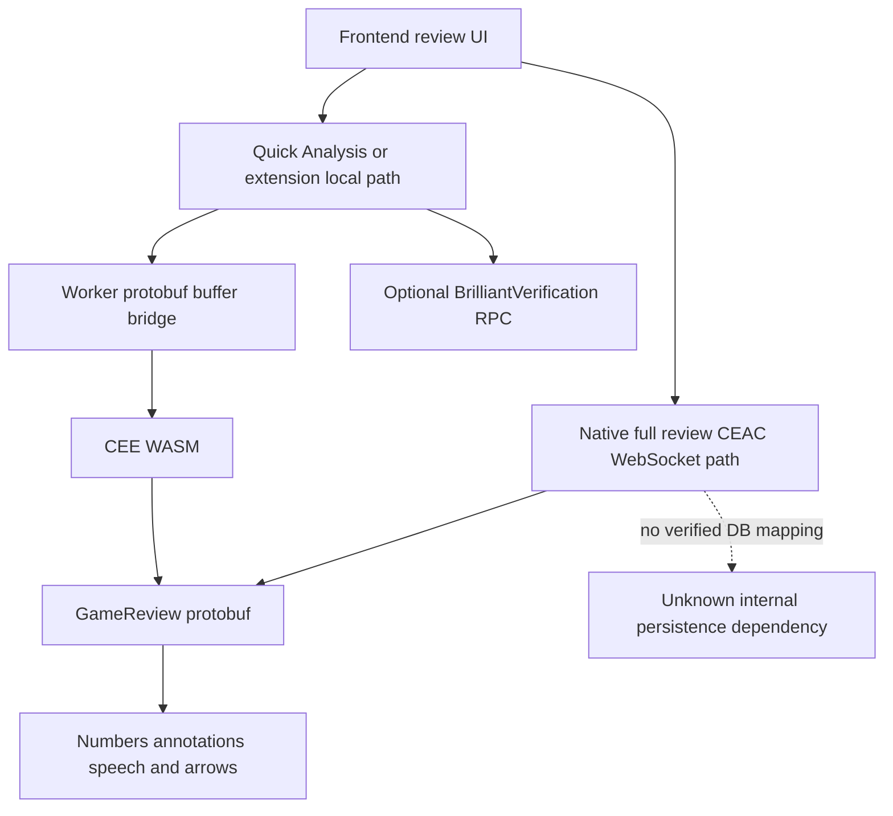
