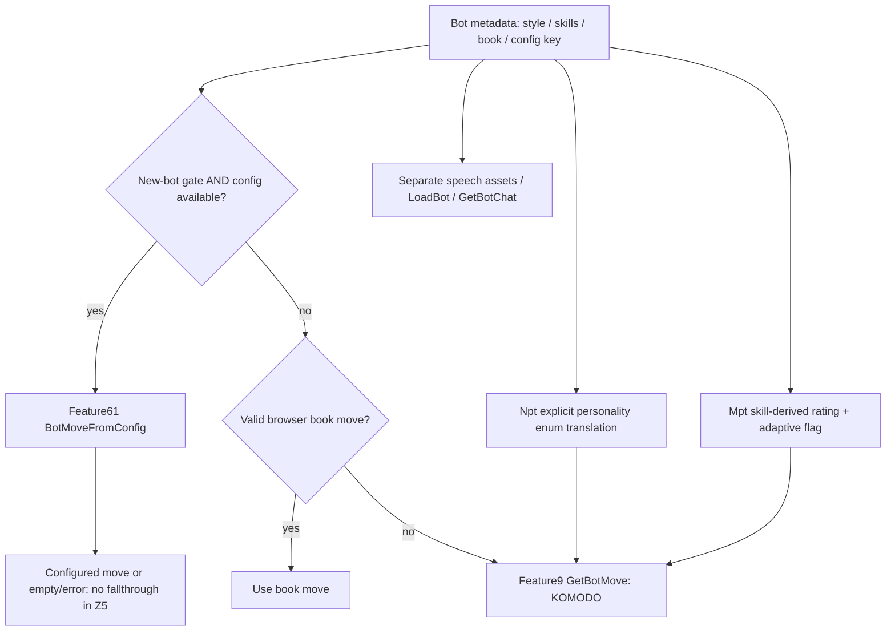
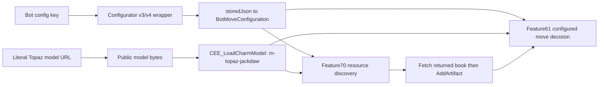
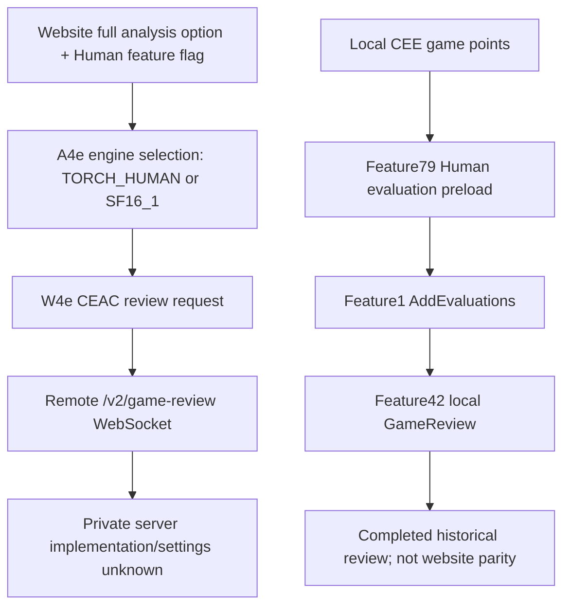

# 07 — Focused architecture diagrams

[Start](00_START_HERE.md)

## Bot move generation — recovered static ordering

## Configured path setup — static plus selected native confirmation

Feature70's NN requirement was present without the model and absent after it loaded in the native diagnostic. Frontend setup consumes book resources at this callsite; production config values were not retrieved.

## Human review: two related but non-identical execution paths

Diagrams explain evidenced interfaces, not undisclosed server topology. There is deliberately no arrow equating BotPersonality.HUMAN, TorchSearchMode.human, Maia and the recovered Charm-small model.
