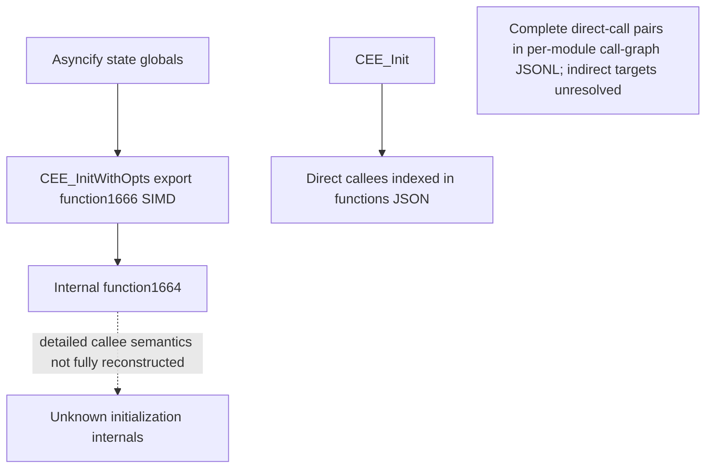

# WASM call graphs

[Master](../00_WASM_MASTER_INDEX.md)

Completeper-modulemachinegraphsareinmodules/<id>/call-graph.jsonl.gz. Graphsincludeexactdirectcallsbutnotresolveddynamiccall_indirecttargets.

