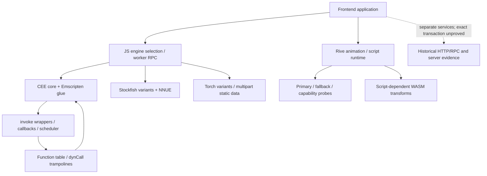

# Architecture and reconstructability

## Focused Torch Human / bot-personality follow-up

The focused follow-up demonstrates actual local Charm-small execution but does not establish private cloud parity or recover all native scoring/sampling equations. Reconstructability remains partial.

[Evidence-graded focused update](../../torch-human-bots-update/00_START_HERE.md) · [Overlay change manifest](../../torch-human-bots-update/TORCH_HUMAN_BOTS_PATCH_MANIFEST.md). This additive notice supersedes narrower earlier interpretations; it does not alter archived original documents.

---

Interop is evidenced through JavaScript selection, marshalling, and imports—not an assumption that all modules directly link. No proven native cross-module graph connects a CEE index to a Stockfish or Rive index; indices are module-local. Worker RPC and buffers are architectural boundaries, not one combined native address space.

### Attribution

- **Stockfish:** strong lineage evidence from glue license/source attribution, UCI/NNUE interfaces, and real NNUE payloads. Exact fork patches and production configuration remain incomplete.
- **Torch:** branding and matching exports do not identify open-source PyTorch or prove equal models.
- **CEE:** application-specific explanation/feature logic mixed with substantial C++/Emscripten runtime. Compiler helpers must not be counted as business algorithms.
- **Rive:** third-party graphics/script runtime, separate from CEE review classification.

Historical backend chapters remain historical/public/secondary evidence. This pass does not turn CloudSQL/MySQL/PHP/Symfony observations into private endpoints, table schemas, SQL statements, or recovered server-side CEAC algorithms.

### What can be reconstructed

**Now:** exact ABIs and static structures; selected handle/container algorithms; JS copy/free behavior; loader retry/variant logic; selected raw decompilation.

**With substantial further work:** CEE feature factories/schemas/CFGs; Torch search/evaluation; tensor formats; virtual dispatch; allocation lifetimes.

**Not from this evidence alone:** original names/comments/typedefs; private encryption keys; unobserved runtime inputs and backend databases; all unobserved builds; behavioral parity without controlled functional tests.
